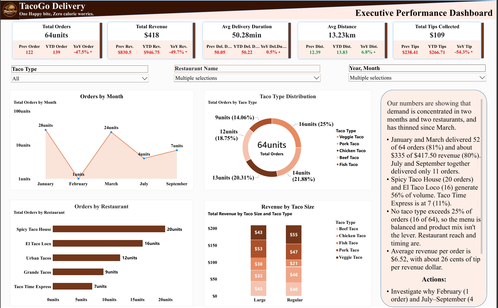
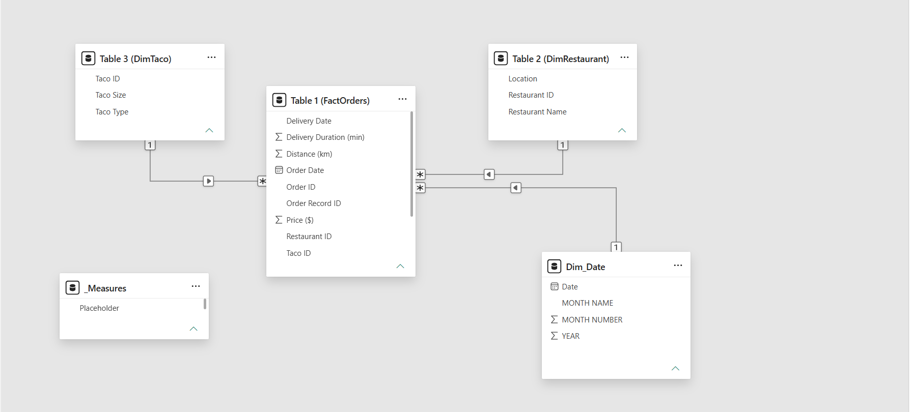
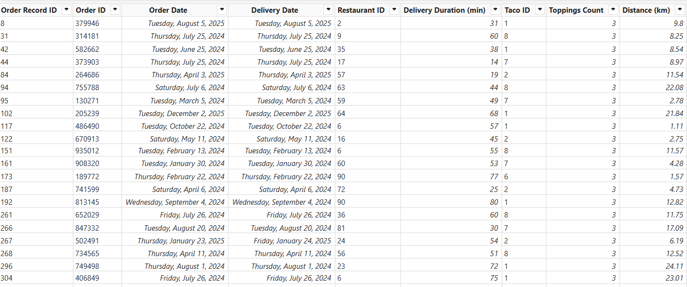
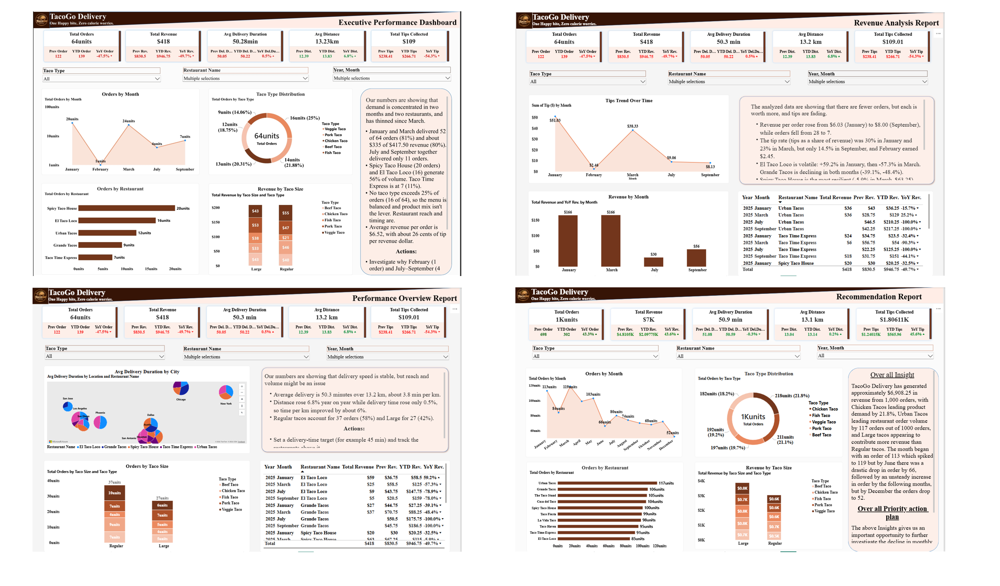

# TacoGo Delivery: Order Decline Diagnostics and Automated Weekly BI Reporting


> Orders are down 47.5% year over year. **Where is the loss concentrated, is it a product, speed or reach problem, and how can leadership track it every Monday without anyone building the report by hand?**

**Project resources:** [Live Dashboard](https://app.powerbi.com/view?r=eyJrIjoiNjQ2ZTZkMGMtMzVlZi00MTYzLThiNGMtYjhmZDM3ZGZiYjIzIiwidCI6ImI2YTZhZWM2LTc5OTktNDhhYS04YTVlLWYwN2JlMjEzZGJlYyJ9) | [PDF Project Report](docs/geopulse_project_report.pdf) | [Project Design Plan](docs/project_blueprint.md)
> 
---

## Executive Summary

TacoGo's management asked for deeper insight and less manual reporting after the first delivery dashboard. I extended the Power BI report to four pages with Prev, YTD and YoY KPI cards, and built a Power Automate flow that emails the latest report every Monday.

**What the numbers say** (analysed slice: 64 orders across five restaurants and five months of 2025, see [Scope and Limitations](#scope-and-limitations)):

| KPI | Current | Prior year | YoY |
|---|---|---|---|
| Orders | 64 | 122 | **-47.5%** |
| Revenue | $418 | $830.50 | **-49.7%** |
| Tips | $109.01 | $238.41 | **-54.3%** |
| Avg delivery duration | 50.28 min | 50.05 min | +0.5% |
| Avg distance | 13.23 km | 12.39 km | +6.8% |

- **The decline is a reach and timing problem, not a product or speed problem.** January and March delivered 52 of 64 orders (81%). February recorded 1 order and July plus September together recorded 11. Two restaurants account for 56% of volume, and no taco type exceeds 25% of orders.
- **Delivery operations held steady.** Distance rose 6.8% while duration rose 0.5%, so time per km improved about 6% (4.04 to 3.80 min/km).
- **Monetisation is weakening faster than volume.** Revenue per order is about 4% below last year ($6.52 vs $6.81), and tips per order fell about 13% ($1.95 to $1.70). The tip rate fell from 30% in January to 14.5% in September.
- **The full dataset (1,000 orders, $6,908.25 revenue, $1.81K tips)** shows the same late-year softness: pooled monthly orders peak at 119 in March and end at 52 in December, a 56% drop.

---

## Business Context

TacoGo Delivery is a multi-restaurant taco delivery business operating across ten restaurants and several US metros (including Phoenix, Chicago, Los Angeles, Dallas, Houston and New York). Management had a descriptive delivery performance dashboard but lacked three things:

1. A **like-for-like comparison** against the prior year and year to date.
2. A way to **isolate where** a decline sits (month, restaurant, product, delivery performance).
3. A **recurring, hands-off report** so the business reviews trends weekly rather than on request.

---

## Objectives

1. Quantify movement in orders, revenue, delivery duration, distance and tips using Prev, YTD and YoY KPI cards.
2. Locate the decline by month, restaurant and product mix.
3. Test whether delivery performance (duration against distance) explains the drop.
4. Automate a Monday email delivering the latest visuals and written insights through Power Automate.
5. Convert findings into prioritised, measurable actions.

---

## Data Overview

**Model:** star schema in Power BI, 1,000 order records dated January 2024 to December 2025.


| Table | Grain | Key fields |
|---|---|---|
| `FactOrders` | One row per order (1,000 rows) | Order Date, Delivery Date, Delivery Duration (min), Distance (km), Price ($), Tip ($), Toppings Count, Weekend Order |
| `DimRestaurant` | One row per restaurant | Restaurant ID, Restaurant Name, Location |
| `DimTaco` | One row per taco | Taco ID, Taco Type, Taco Size |
| `Dim Date` | One row per date | Date, Month Name, Month Number, Year |




**Report pages**

| Page | Purpose |
|---|---|
| Executive Performance Dashboard | KPIs, orders by month, restaurant and taco type, revenue by size |
| Revenue Analysis Report | Tips trend, revenue by month, restaurant-level YoY table |
| Performance Overview Report | Delivery duration by city, orders by taco size, restaurant YoY table |
| Recommendation Report | Full 1,000-order view with overall insight and priority actions |


---

## Key Findings

### 1. Demand is concentrated in two months

| Month | Orders | Revenue | Tips |
|---|---|---|---|
| January | 28 | $166 | $51.03 |
| February | 1 | n/a | $2.46 |
| March | 24 | $166 | $38.33 |
| July | 4 | $30 | $9.06 |
| September | 7 | $56 | $8.13 |

January and March hold 81% of orders and about 80% of revenue. July and September average 5.5 orders per month, a 79% fall from the January and March average of 26. September (7) is up 75% on July (4), but from a very low base.

### 2. Restaurant performance is uneven and volatile

Revenue (2025) with YoY change by restaurant:

| Restaurant | Orders | Jan | Mar | Jul | Sep |
|---|---|---|---|---|---|
| Spicy Taco House | 20 | $20 (-32.5%) | $63 (-5.9%) | $20 (-53.2%) | $34 (+164.7%) |
| El Taco Loco | 16 | $59 (+59.2%) | $25 (-57.3%) | $9 (-78.9%) | $5 (-78.0%) |
| Urban Tacos | 12 | $36 (-15.7%) | $36 (+25.2%) | none | none |
| Grande Tacos | 9 | $27 (-39.1%) | $37 (-48.4%) | none | none |
| Taco Time Express | 7 | $24 (-32.4%) | $6 (-90.3%) | none | $18 (-44.1%) |

- **Spicy Taco House** is the most resilient and the only restaurant growing in September. It contributes about a third of slice revenue.
- **El Taco Loco** swings from +59.2% to -57.3% in two months, which points to a one-off driver in January rather than a stable base.
- **Grande Tacos** declines in both months it trades (-39.1%, -48.4%). Urban Tacos and Grande Tacos recorded no revenue in July or September.
- **Taco Time Express** holds only 11% of volume (7 orders) and fell 90.3% in March.

### 3. Product mix is balanced, so it is not the lever

- Taco types range from 9 to 16 orders (14.06% to 25%). None exceeds 25%.
- Regular tacos account for 37 orders (58%) and Large for 27 (42%).
- Large generates a similar revenue total to Regular (about $210 vs $209) from 10 fewer orders, or roughly **$7.78 vs $5.65 per order (+38%)**. Derived from rounded chart labels.

### 4. Delivery speed is stable and getting more efficient

| Metric | Current | Prior year | Change |
|---|---|---|---|
| Duration | 50.28 min | 50.05 min | +0.5% |
| Distance | 13.23 km | 12.39 km | +6.8% |
| Minutes per km | 3.80 | 4.04 | -5.9% |

### 5. Tips are fading faster than revenue

- Tips fell 54.3% YoY against a 49.7% fall in revenue.
- Tip rate: 30% (January), 23% (March), 14.5% (September). Monthly tips dropped from $51.03 to $8.13 (-84%).

### 6. Full dataset context (1,000 orders)

- Revenue $6,908.25, tips $1.81K, $6.91 revenue per order, tip rate about 26%.
- Taco demand is flat: Chicken leads with 218 orders (21.8%), Beef trails with 182 (18.2%), a 3.6-point spread.
- Order volume by restaurant ranges from 117 (Urban Tacos) to 85 (El Taco Loco).
- Large tacos contribute about $3.8K against about $3.0K for Regular (rounded chart labels).
- Rankings in the filtered slice differ from the portfolio. El Taco Loco is second in the slice but last overall, so conclusions about individual restaurants should be read with the filter context in mind.

---

## Recommendations

| Priority | Action | Evidence | KPI to track |
|---|---|---|---|
| 1 | Investigate the February and July to September collapse: restaurant availability, promotion calendar, listing visibility | 1 order in February, 4 in July, 7 in September vs 28 and 24 in peak months | Monthly orders, target the January and March average of 26 |
| 2 | Test Spicy Taco House's offer and operating hours at Taco Time Express | Spicy is the most resilient (-5.9% in March, +164.7% in September); Taco Time Express holds 11% of volume | Taco Time Express orders and revenue YoY |
| 3 | Run a performance review with Grande Tacos on menu and pricing | -39.1% and -48.4% in active months, no revenue in July or September | Grande Tacos revenue YoY |
| 4 | Decode El Taco Loco's January spike and replicate it | +59.2% in January, then -57.3% in March | Revenue volatility (month-on-month swing) |
| 5 | Investigate the September tip drop (delivery experience or order mix) | Tip rate 14.5% vs 30% in January | Tip rate, tips per order |
| 6 | Set a 45-minute delivery target and review the radius of any restaurant that is both slow and far | Average 50.28 min vs the 45-minute target | % of orders under 45 min |
| 7 | Identify which restaurants and products contribute most to profit | Recommendation page priority; requires cost data (see below) | Contribution margin |

**Not recommended as a lever:** menu rebalancing. Taco type mix is already even.

---

## Scope and Limitations

- Pages 1 to 3 are filtered to five restaurants and five 2025 months (January, February, March, July, September). The headline YoY figures describe this slice, not the entire business. The unfiltered page uses all 1,000 orders.
- The dataset has no cost field, so conclusions are about revenue and tips, not profit.
- Several derived figures (revenue per order by size, per-restaurant shares) use rounded chart labels and are approximate.

---

## Repository Structure

```
tacogo-delivery-bi/
├── README.md
├── report/                  # Power BI file (.pbix)
├── automation/              # Power Automate workflow screenshot and flow description
├── outputs/                 # PDF of the weekly email report
├── images/                  # Dashboard page screenshots used in this README
└── docs/
    └── dashboard_walkthrough.md   # Page-by-page insights, data dictionary, validation log
```

**Tools:** Power BI (data model, DAX, report design), Power Automate (scheduled weekly flow), PDF export.
